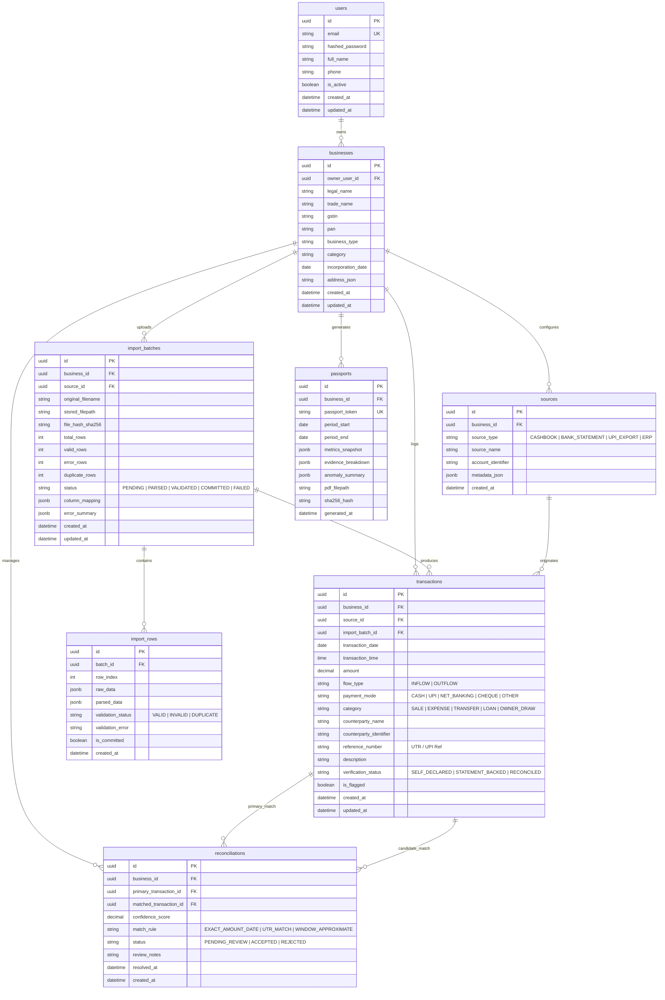

# ArthSetu — Master Implementation Plan

> **Product:** Secure Financial Visibility Platform for Micro-Enterprises in India  
> **Context:** 24-Hour Hackathon Development Lifecycle  
> **Target Audience:** All 4 Engineering Teammates (Frontend, Backend Foundation, Data Pipeline, Financial Engine)  
> **Document Version:** 1.0.0  
> **Status:** APPROVED FOR EXECUTION  

---

## 1. Project Overview & Philosophy

### 1.1 Problem Statement
In India's micro-enterprise sector (kirana shops, small neighbourhood retailers, informal service providers), business owners generate substantial economic turnover but frequently maintain fragmented, non-standard financial records. Their financial transactions are scattered across:
- Daily physical cashbooks and diaries (*kacha khata*).
- UPI transaction histories (PhonePe, Google Pay, Paytm, BharatPe) exported as CSVs/PDFs.
- Bank statement PDFs or Excel exports.
- Supplier invoices and cash receipts.
- Informal credit ledgers (*udhar bahi*).

Consequently, traditional lending and formal credit institutions struggle to assess these businesses because they lack consolidated, clean, and verifiable records.

### 1.2 Our Solution: ArthSetu
ArthSetu (*"Bridge of Economic Value"*) is a specialized financial visibility and evidence-synthesis platform designed for micro-enterprises. It enables a micro-retailer to:
1. Ingest heterogeneous financial inputs (manual entries, UPI exports, bank CSVs).
2. Cleanse, validate, and de-duplicate messy transaction rows.
3. Reconcile overlapping channels (e.g., matching a UPI receipt in a bank statement against cash counter records).
4. Analyze financial metrics (recorded sales, operating rhythm, digital vs. cash split, completeness).
5. Generate an objective, tamper-evident **Financial Visibility Passport** document summarizing verifiable operational activity.

### 1.3 Boundary Clarification: What ArthSetu Is NOT
To preserve regulatory compliance and architectural sanity within a 24-hour sprint, all teammates must adhere strictly to these boundaries:
- **NOT a Bank or Lending Platform:** ArthSetu does not issue credit, approve loans, or disburse funds.
- **NOT a Credit Scoring System:** We do not issue FICO/CIBIL-like credit scores. We compute *evidence-quality* and *completeness metrics*.
- **NOT an Audited Accounting System:** We do not replace Tally, Zoho Books, or a Chartered Accountant.
- **NOT a Regulated Account Aggregator (AA):** We do not pull live banking feeds via NBFC-AA licenses.
- **NOT a Fraud Detection System:** Flagged anomalies are data inconsistencies or statistical outliers, not judicial fraud findings.
- **Owner-Supplied Evidence Disclaimer:** All uploaded files are **owner-supplied records**, not independently audited bank feeds. The system highlights provenance and consistency, never absolute third-party verification.

---

## 2. Team Responsibilities & Ownership Matrix

| Teammate | Role Domain | Primary Technical Stack | Primary File Paths & Deliverables |
| :--- | :--- | :--- | :--- |
| **Teammate 1** | **Frontend Experience** | React 18, Vite, TypeScript, Tailwind CSS, React Router v6, Recharts, Lucide Icons | `frontend/src/pages/*`<br>`frontend/src/components/*`<br>`frontend/src/services/*` |
| **Teammate 2** *(Lead/You)* | **Backend Foundation & Security** | Python 3.10+, FastAPI, PostgreSQL, SQLAlchemy 2.0, Pydantic v2, Alembic, Jose/Bcrypt | `backend/app/core/*`<br>`backend/app/db/*`<br>`backend/app/models/*`<br>`backend/app/api/v1/auth.py`<br>`backend/app/api/v1/businesses.py`<br>`backend/app/api/v1/transactions.py` |
| **Teammate 3** | **Data Ingestion & Reconciliation** | Python, Pandas, FastAPI, SQLAlchemy, Pydantic | `backend/app/api/v1/imports.py`<br>`backend/app/api/v1/reconciliation.py`<br>`backend/app/services/import_service.py`<br>`backend/app/services/validation_service.py`<br>`backend/app/services/duplicate_service.py`<br>`backend/app/services/reconciliation_service.py` |
| **Teammate 4** | **Financial Analysis & Passport** | Python, NumPy/Pandas, ReportLab / FPDF2, FastAPI, SQLAlchemy | `backend/app/api/v1/analysis.py`<br>`backend/app/api/v1/passports.py`<br>`backend/app/services/metrics_service.py`<br>`backend/app/services/completeness_service.py`<br>`backend/app/services/anomaly_service.py`<br>`backend/app/services/evidence_service.py`<br>`backend/app/services/passport_service.py` |

---

## 3. Architecture Overview

### 3.1 Architectural Principles
1. **Single Backend & Shared Database:** There is only ONE FastAPI app (`backend/app/main.py`) and ONE PostgreSQL database instance. Teammates 3 and 4 write services that integrate into Teammate 2's core database models and routers. No secondary backend services or SQLite sidecars.
2. **Zero-Trust Multi-Tenancy:** Every query filter, insert, and update MUST be scoped to the authenticated user's `business_id` verified via JWT. Never accept an unverified `business_id` or `user_id` from query params or request bodies.
3. **Stateless Analysis & Cached Snapshots:** Metrics can be computed dynamically on transactions, but Passports freeze metrics into JSON snapshots stored with a cryptographic hash.
4. **Deterministic Logic Over Black-Box ML:** Prioritize explicit business rules, rolling sums, and IQR outlier detection over opaque machine-learning models.

### 3.2 Target System Topology

```
                  ┌────────────────────────────────────────┐
                  │          React 18 + Vite SPA           │
                  │   (Tailwind CSS, React Router, Recharts)│
                  └───────────────────┬────────────────────┘
                                      │ HTTPS / JSON / Bearer JWT
                                      ▼
                  ┌────────────────────────────────────────┐
                  │             FastAPI Router             │
                  │       (/api/v1 - Auth & CORS Layer)    │
                  └───────────────────┬────────────────────┘
                                      │
         ┌────────────────────────────┼────────────────────────────┐
         │ (Teammate 2)               │ (Teammate 3)               │ (Teammate 4)
         ▼                            ▼                            ▼
┌───────────────────┐       ┌───────────────────┐        ┌───────────────────┐
│ Core Services     │       │ Ingestion Engine  │        │ Analytics & PDF   │
│ - Auth (JWT/Hash) │       │ - CSV Parser      │        │ - Metric Engine   │
│ - Business Profile│       │ - Column Mapper   │        │ - Completeness    │
│ - Transaction CRUD│       │ - Normalizer      │        │ - Anomaly / IQR   │
│ - Tenant Guard    │       │ - Reconciler      │        │ - Passport PDF    │
└─────────┬─────────┘       └─────────┬─────────┘        └─────────┬─────────┘
          │                           │                            │
          └───────────────────────────┼────────────────────────────┘
                                      │ SQLAlchemy 2.0 (Async/Sync Session)
                                      ▼
                      ┌───────────────────────────────┐
                      │      PostgreSQL Database      │
                      │  (Relational Tenant Schema)   │
                      └───────────────────────────────┘
                                      │ File System Storage
                                      ▼
                      ┌───────────────────────────────┐
                      │    storage/ (Local Server)    │
                      │  - /imports/ (Raw CSVs)       │
                      │  - /passports/ (Signed PDFs)  │
                      └───────────────────────────────┘
```

---

## 4. Strict Financial & Metric Calculation Rules

All formulas across Backend (Teammate 4), Ingestion (Teammate 3), and UI (Teammate 1) must use identical definitions:

| Metric Name | Authoritative Formula | Prohibited Terminology |
| :--- | :--- | :--- |
| **Recorded Sales** | $\sum \text{Eligible Credit Transactions marked as Sale/Revenue}$ | Do NOT label as "Audited Turnover" |
| **Recorded Expenses** | $\sum \text{Eligible Debit Transactions marked as Expense}$ | Do NOT label as "Allowable Tax Deductions" |
| **Net Recorded Cash Movement** | $\text{Recorded Inflows} - \text{Recorded Outflows}$ | **NEVER call this "Profit" or "Net Income"** |
| **Digital Sales Share (%)** | $\left( \frac{\text{Digital Recorded Sales}}{\text{Total Recorded Sales}} \right) \times 100$ | Express as percentage (0.0% to 100.0%) |
| **Expense-to-Sales Ratio (%)** | $\left( \frac{\text{Recorded Expenses}}{\text{Recorded Sales}} \right) \times 100$ | **NEVER label as "Audited Profit Margin"** |
| **Operating-Day Coverage (%)** | $\left( \frac{\text{Count of unique days with } \ge 1 \text{ transaction}}{\text{Total calendar days in selected period}} \right) \times 100$ | Shows consistency of daily business |

### 4.1 Statistical Anomaly Rules (Teammate 4)
1. **IQR Rule:** Calculate $Q_1$ (25th percentile) and $Q_3$ (75th percentile) of daily sales. $\text{IQR} = Q_3 - Q_1$.  
   Flag values $> Q_3 + 1.5 \times \text{IQR}$ as *"High-value transaction outliers"* or $< Q_1 - 1.5 \times \text{IQR}$ as *"Low-activity days"*.
2. **Strict Rule on Outliers:** **IQR outliers must NEVER be labeled as "Fraud" or "Invalid".** They are labeled as *"Unusual Activity Requiring Owner Verification"*.
3. **Threshold Guard:** Only run IQR outlier detection when at least 30 transaction records exist. For datasets $< 30$ records, return `insufficient_sample_size: true`.

### 4.2 Five Dimensions of Evidence Quality (Teammate 4 & Teammate 1)
Evidence quality score (0–100) must break down into five distinct, un-merged dimensions:
1. **Provenance:** Origin of record (Bank Statement CSV > Digital Payment UPI Export > Manual Diary Entry).
2. **Source Status:** Self-declared vs. export file vs. duplicate-detected.
3. **Completeness:** Presence of required fields (date, amount, counterparty, description, reference ID).
4. **Consistency:** Balance continuity, absence of contradictory records on same timestamp.
5. **Traceability:** Availability of transaction reference numbers (UTR, UPI ID, Cheque Number).

---

## 5. Master Database Schema Plan (Teammate 2)

All teammates rely on this unified schema.



---

## 6. Shared API Contract Standards

### 6.1 Base URL & Response Envelope
- Base path: `/api/v1`
- Standard Success Response Envelope:
```json
{
  "success": true,
  "data": { ... },
  "message": "Operation completed successfully"
}
```
- Standard Error Response Envelope:
```json
{
  "success": false,
  "error": {
    "code": "RESOURCE_FORBIDDEN",
    "message": "You do not own this business entity",
    "details": []
  }
}
```
- Standard Auth Header:
```http
Authorization: Bearer <JWT_ACCESS_TOKEN>
```

### 6.2 Key Endpoint Definitions

| Method | Endpoint | Owner | Description | Request Body / Params | Expected Response |
| :--- | :--- | :--- | :--- | :--- | :--- |
| `POST` | `/auth/register` | T2 | Create user account | `{ email, password, full_name, phone }` | `{ user: { id, email } }` |
| `POST` | `/auth/login` | T2 | Authenticate & issue JWT | Form `{ username, password }` | `{ access_token, token_type }` |
| `GET` | `/auth/me` | T2 | Fetch current user | — | Current user profile |
| `GET` | `/businesses` | T2 | List user's businesses | — | List of owned business profiles |
| `POST` | `/businesses` | T2 | Register business profile | `{ legal_name, trade_name, gstin, pan, business_type }` | Created business object |
| `GET` | `/transactions` | T2 | Paginated & filtered list | `?business_id=&start_date=&end_date=&flow_type=&page=&limit=` | `{ items: [], total, page }` |
| `POST` | `/transactions` | T2 | Single transaction entry | `{ business_id, transaction_date, amount, flow_type, payment_mode, category, ... }` | Created transaction |
| `POST` | `/imports/upload` | T3 | Upload raw CSV | `multipart/form-data: file, business_id, source_type` | `{ batch_id, total_rows_detected, raw_columns, sample_rows: [] }` |
| `POST` | `/imports/{batch_id}/map-columns`| T3 | Submit column mapping & parse | `{ mapping: { date_col: "Date", amount_col: "Amt", ... } }` | `{ valid_count, error_count, preview: [] }` |
| `POST` | `/imports/{batch_id}/commit` | T3 | Commit valid rows to transactions | `{ overwrite_duplicates: false }` | `{ imported_records_count, batch_status: "COMMITTED" }` |
| `GET` | `/reconciliation/candidates` | T3 | Find potential duplicate/match pairs| `?business_id=` | `{ candidates: [ { primary, matched, confidence, rule } ] }` |
| `POST` | `/reconciliation/resolve` | T3 | Accept/reject match | `{ reconciliation_id, action: "ACCEPT"|"REJECT" }` | `{ status: "RESOLVED" }` |
| `GET` | `/analysis/summary` | T4 | Overall financial metrics | `?business_id=&start_date=&end_date=` | `{ recorded_sales, recorded_expenses, net_cash_movement, digital_share, ... }` |
| `GET` | `/analysis/completeness` | T4 | Data coverage & gaps | `?business_id=&start_date=&end_date=` | `{ operating_days_coverage, missing_dates: [], record_continuity_score }` |
| `GET` | `/analysis/anomalies` | T4 | Rule-based & IQR anomalies | `?business_id=` | `{ anomalies: [ { date, amount, reason, severity } ] }` |
| `GET` | `/analysis/evidence-quality`| T4 | 5-dimension evidence score | `?business_id=` | `{ overall_score, provenance_score, completeness_score, ... }` |
| `POST` | `/passports/generate` | T4 | Compile metrics & create PDF | `{ business_id, period_start, period_end }` | `{ passport_token, generated_at, download_url }` |
| `GET` | `/passports/{token}/download`| T4 | Secure PDF download | — | PDF stream (Content-Disposition: attachment) |

---

## 7. Phase-Wise Implementation Roadmap

```mermaid
gantt
    title 24-Hour Hackathon Development Timeline
    dateFormat  HH:mm
    axisFormat %H:%M

    section Phase 1: Planning & Setup
    Architecture, Schema & Contracts Alignment :done, p1, 00:00, 2h

    section Phase 2: Foundation
    T2 - Database, Models, Auth & Security Guard :active, p2_t2, 02:00, 3h
    T1 - UI Scaffolding, Router & Mock Services :active, p2_t1, 02:00, 3h
    T3 - CSV Parser & Column Normalizer Engine :active, p2_t3, 02:00, 3h
    T4 - Metric Formulas & PDF Generator Shell :active, p2_t4, 02:00, 3h

    section Phase 3: Module Implementation
    T2 - Business & Transaction CRUD with Tenant Check :p3_t2, 05:00, 5h
    T1 - Auth, Dashboard, Transactions UI Pages :p3_t1, 05:00, 5h
    T3 - Batch Ingestion, Duplicate Detection, Recon API :p3_t3, 05:00, 5h
    T4 - Analytics API, Anomaly/IQR, Evidence Scoring :p3_t4, 05:00, 5h

    section Phase 4: Integration
    Frontend + Backend API Wiring (All Teammates) :p4, 10:00, 6h
    Ingestion -> Transactions -> Analysis Data Pipeline :p4_pipe, 12:00, 4h

    section Phase 5: Verification & Polish
    Two-User Isolation & Security Testing :p5_sec, 16:00, 3h
    Passport PDF Polish & Recharts Aesthetics :p5_pol, 18:00, 3h
    End-to-End Demo Dry Run & Edge Case Fixes :p5_demo, 21:00, 3h
```



---

## 8. Detailed Tasks for Every Teammate

### 8.1 Teammate 1 — Frontend Experience

| Task ID | Task Description | Prerequisites | Deliverable | Definition of Done | Cross-Dependencies |
| :--- | :--- | :--- | :--- | :--- | :--- |
| **T1-01** | Install missing frontend dependencies (`tailwindcss`, `postcss`, `autoprefixer`, `recharts`) & configure tailwind.config.js | None | `frontend/package.json`, `tailwind.config.js` | `npm run build` succeeds; Tailwind classes render correctly. | None |
| **T1-02** | Configure Router, AuthContext, & Navigation Shell (`Navbar`, `Sidebar`, `AppLayout`) | T1-01 | `src/context/AuthContext.tsx`, `src/components/layout/*` | Responsive layout rendered with route guards redirecting to `/login` if unauthenticated. | T2-04 (Auth token format) |
| **T1-03** | Build Login & Registration UI with client-side validation | T1-02 | `src/pages/Login.tsx`, `src/pages/Register.tsx` | Forms validate inputs, display error toasts, and store JWT on success. | T2-04 (Auth API) |
| **T1-04** | Build Business Profile Onboarding form | T1-02 | `src/pages/BusinessProfile.tsx` | Allows entering legal name, GSTIN, PAN, and business category with instant feedback. | T2-05 (Business API) |
| **T1-05** | Build Manual Transaction Entry & Data Table with filters (Date, Inflow/Outflow, Mode) | T1-02 | `src/pages/Transactions.tsx` | Table displays records with badges for payment modes; manual modal adds transaction. | T2-06 (Txn CRUD API) |
| **T1-06** | Build CSV File Upload, Column Mapper & Preview Table | T1-02 | `src/pages/ImportData.tsx` | File drag-and-drop, dropdown column mapping, preview of parsed rows with error highlights. | T3-02, T3-03 (Import API) |
| **T1-07** | Build Reconciliation Interface with side-by-side match cards | T1-05 | `src/pages/Reconciliation.tsx` | Shows suggested match pairs, confidence badge, and "Accept Match" / "Reject" buttons. | T3-05 (Recon API) |
| **T1-08** | Build Financial Insights & Evidence Quality Dashboard with Recharts | T1-02 | `src/pages/Insights.tsx`, `src/pages/Dashboard.tsx` | KPI cards for recorded sales/expenses; cash vs. digital donut chart; 5-dimension radar/bar chart. | T4-02, T4-03 (Analysis API) |
| **T1-09** | Build Financial Visibility Passport Viewer & PDF Download trigger | T1-08 | `src/pages/Passport.tsx` | Displays passport preview card with security hash, metrics summary, and instant download button. | T4-04 (Passport API) |

---

### 8.2 Teammate 2 — Backend Foundation & Security (You)

| Task ID | Task Description | Prerequisites | Deliverable | Definition of Done | Cross-Dependencies |
| :--- | :--- | :--- | :--- | :--- | :--- |
| **T2-01** | Review and finalize `requirements.txt` (add `reportlab`, `python-multipart`, `pydantic-settings`), verify dependencies install cleanly | None | `backend/requirements.txt` | Clean virtualenv installation without conflicts. | All Teammates |
| **T2-02** | Configure database session manager (`session.py`, `base.py`, `config.py`) supporting local Postgres & Docker | T2-01 | `backend/app/db/session.py`, `backend/app/core/config.py` | Connection test script connects, executes `SELECT 1`, and logs success. | T3, T4 |
| **T2-03** | Implement complete SQLAlchemy Models with relations (`User`, `Business`, `Transaction`, `Source`, `ImportBatch`, `ImportRow`, `Reconciliation`, `Passport`) | T2-02 | `backend/app/models/*.py` | All tables, foreign keys, and indexes defined with standard timestamps. | T3, T4 |
| **T2-04** | Setup Alembic, generate initial migration script, and verify migration execution | T2-03 | `backend/alembic/versions/*.py` | `alembic upgrade head` creates all 8 tables in PostgreSQL cleanly. | All Teammates |
| **T2-05** | Implement Auth Services & Security Utils (bcrypt hashing, JWT creation/decoding, `get_current_user` dependency) | T2-03 | `backend/app/core/security.py`, `backend/app/core/dependencies.py`, `backend/app/api/v1/auth.py` | Unit tests verify password hash/verify, token expiration, and route protection. | T1-03 |
| **T2-06** | Implement Business Profile CRUD APIs with strict User-Ownership guard | T2-05 | `backend/app/api/v1/businesses.py`, `backend/app/services/business_service.py` | Users can only view/edit their own business; unauthorized access returns 403. | T1-04, T3, T4 |
| **T2-07** | Implement Transaction CRUD APIs with pagination, date filters, and Business-Ownership guard | T2-06 | `backend/app/api/v1/transactions.py`, `backend/app/services/transaction_service.py` | Fully validated CRUD endpoints operating with tenant isolation. | T1-05, T3, T4 |
| **T2-08** | Write Automated Security & Multi-Tenant Isolation Tests (2 separate users verification) | T2-07 | `backend/tests/test_ownership.py`, `backend/tests/test_auth.py` | `pytest` passes with 100% assertions verifying User A cannot view User B's transactions or businesses. | Crucial for Hackathon Demo |

---

### 8.3 Teammate 3 — Data Processing & Reconciliation

| Task ID | Task Description | Prerequisites | Deliverable | Definition of Done | Cross-Dependencies |
| :--- | :--- | :--- | :--- | :--- | :--- |
| **T3-01** | Implement CSV file storage & SHA-256 batch hasher | T2-03 | `backend/app/services/import_service.py` | Uploaded CSV saved into `storage/imports/` and duplicate batch uploads flagged via file hash. | T2-03 (ImportBatch model) |
| **T3-02** | Implement robust CSV Parser & Column Autodetection (supporting PhonePe, GPay, Paytm, generic CSV formats) | T3-01 | `backend/app/services/validation_service.py` | Heuristics recognize common date formats (DD/MM/YYYY, YYYY-MM-DD) and credit/debit column headers. | T1-06 |
| **T3-03** | Implement Column Mapping & Row Normalization endpoint (`POST /imports/{id}/map-columns`) | T3-02 | `backend/app/api/v1/imports.py` | Standardizes mapped columns into normalized `TransactionCreate` schemas with row validation logs. | T1-06, T2-03 |
| **T3-04** | Implement In-Batch & Cross-Batch Duplicate Transaction Detector | T3-03 | `backend/app/services/duplicate_service.py` | Flags duplicate rows based on hash of `(transaction_date, amount, reference_number, counterparty)`. | T2-07 |
| **T3-05** | Implement Batch Commit Pipeline (`POST /imports/{id}/commit`) writing valid rows to `transactions` table | T3-04 | `backend/app/services/import_service.py` | Atomically commits non-duplicate rows into the active `transactions` table under verified `business_id`. | T2-07, T4-01 |
| **T3-06** | Implement Reconciliation Candidate Engine (`GET /reconciliation/candidates`) | T3-05 | `backend/app/services/reconciliation_service.py`, `backend/app/api/v1/reconciliation.py` | Identifies potential match pairs across different sources within a $\pm 2$ day window with equal amounts. | T1-07 |
| **T3-07** | Implement Reconciliation Decision Endpoint (`POST /reconciliation/resolve`) | T3-06 | `backend/app/api/v1/reconciliation.py` | Updates reconciliation record to `ACCEPTED` or `REJECTED` and tags transaction verification status. | T1-07 |

---

### 8.4 Teammate 4 — Financial Analysis & Passport

| Task ID | Task Description | Prerequisites | Deliverable | Definition of Done | Cross-Dependencies |
| :--- | :--- | :--- | :--- | :--- | :--- |
| **T4-01** | Implement Core Financial Metrics Calculator (Recorded Sales, Expenses, Net Movement, Digital Share) | T2-07 | `backend/app/services/metrics_service.py` | Verified against known test cases; enforces all prohibited terms strictly. | T1-08 |
| **T4-02** | Implement Data Completeness & Continuity Evaluator (Operating-Day Coverage, Missing Date Runs) | T4-01 | `backend/app/services/completeness_service.py` | Calculates % operating days over selected date range and identifies unbroken trading streaks. | T1-08 |
| **T4-03** | Implement Rule-Based Anomaly & IQR Outlier Engine | T4-01 | `backend/app/services/anomaly_service.py` | Calculates Q1, Q3, IQR for datasets $\ge 30$ records; flags unusual spikes without calling them fraud. | T1-08 |
| **T4-04** | Implement 5-Dimension Evidence Quality Scoring Algorithm | T4-02 | `backend/app/services/evidence_service.py` | Emits scores for Provenance, Source Status, Completeness, Consistency, and Traceability. | T1-08 |
| **T4-05** | Implement Analytics API Endpoints (`/analysis/summary`, `/analysis/anomalies`, etc.) | T4-01..T4-04 | `backend/app/api/v1/analysis.py` | Returns unified analytics payload scoped to authenticated `business_id`. | T1-08 |
| **T4-06** | Implement Financial Visibility Passport PDF Generator using ReportLab | T4-05 | `backend/app/services/passport_service.py` | Generates a clean 2-page PDF with watermark, business header, metrics table, evidence radar, and SHA-256 seal. | T1-09 |
| **T4-07** | Implement Passport Endpoints (`POST /passports/generate`, `GET /passports/{token}/download`) | T4-06 | `backend/app/api/v1/passports.py` | Freezes passport snapshot in database and serves streamable PDF with token auth check. | T1-09, T2-05 |

---

## 9. Integration Strategy & Cross-Module Dependencies

### 9.1 The Master Pipeline Flow
Data flows systematically across all four teammate boundaries:
```
[T1: File Upload UI] 
        │ (multipart CSV)
        ▼
[T3: Ingestion Service] ──► Validates & Dedupes ──► Commits to [T2: Transactions Table]
                                                                      │
                                                                      ▼
                                                      [T4: Analysis & Metrics Engine]
                                                                      │
                                         ┌────────────────────────────┴──────────────────────────┐
                                         ▼                                                       ▼
                            [T4: Dynamic JSON API]                                  [T4: Passport PDF Service]
                                         │                                                       │
                                         ▼                                                       ▼
                            [T1: Recharts Dashboard]                                [T1: Passport Viewer & Download]
```

### 9.2 Critical Path Analysis
1. **Blocker 1 (Foundation):** Teammate 2 must complete `T2-02` (DB Session), `T2-03` (Models), and `T2-05` (Auth) before T3 or T4 can write database-backed queries.
2. **Mocking Protocol (To Unblock T1, T3, T4 in Hours 1–4):**
   - **T1** unblocks themselves immediately by using `services/api.ts` with local mock JSON objects (matching Section 6 contracts).
   - **T3** unblocks themselves immediately by writing pure unit tests for CSV parsing on sample files in `sample_data/sample_transactions.csv` without needing PostgreSQL running.
   - **T4** unblocks themselves immediately by writing pure function calculations that take a Python list of transaction dictionaries and return metrics.

### 9.3 Git Branching & Merge Etiquette
- `main`: Production-ready, working code only. Never commit broken code directly to `main`.
- `feat/t1-frontend`: Teammate 1 work.
- `feat/t2-backend-core`: Teammate 2 work.
- `feat/t3-data-ingestion`: Teammate 3 work.
- `feat/t4-analytics-passport`: Teammate 4 work.
- **Integration Points:** Every 4 hours, pull `main` into feature branches. When T2 completes core models, merge `feat/t2-backend-core` into `main` immediately so T3 and T4 rebase.

---

## 10. Security & Multi-Tenant Isolation Checklist (Teammate 2 Lead)

- [ ] **Bcrypt Password Hashing:** Passwords stored with minimum 12 salt rounds; plain-text passwords never logged.
- [ ] **JWT Claim Validation:** Tokens expire in 24 hours; contain `sub` (User ID) and signature verified on every request.
- [ ] **Tenant Ownership Dependency (`get_current_business`):** Every API endpoint handling transactions or imports must verify:
  ```python
  business = db.query(Business).filter(Business.id == business_id, Business.owner_user_id == current_user.id).first()
  if not business:
      raise HTTPException(status_code=403, detail="Access to specified business is forbidden")
  ```
- [ ] **Never Trust Client Body IDs:** Discard any `user_id` or `business_id` passed in JSON payloads; always inject verified ID from JWT context.
- [ ] **Directory Traversal Protection:** Sanitize filenames for CSV imports and Passport PDFs (`secure_filename` or UUID-based naming). Never store or read user-controlled file paths.
- [ ] **SQL Injection Prevention:** 100% parameterized queries via SQLAlchemy 2.0 ORM.
- [ ] **Two-Tenant Security Test:** An automated test must prove:
  - User 1 logs in, creates Business 1, adds Transaction 1.
  - User 2 logs in, creates Business 2.
  - User 2 attempts `GET /transactions?business_id=<Business_1_ID>` $\rightarrow$ receives `403 Forbidden`.
  - User 2 attempts `GET /passports/<Business_1_Passport_Token>/download` $\rightarrow$ receives `403 Forbidden`.

---

## 11. MVP vs. Optional Scope Matrix (24-Hour Hackathon Discipline)

| Module | Must-Have for MVP (Commit by Hour 18) | Optional / Post-MVP (Only if time permits) |
| :--- | :--- | :--- |
| **Frontend (T1)** | - Auth (Login/Register)<br>- Business Setup<br>- Manual & CSV Upload UI<br>- Metric KPI Cards & Donut Chart<br>- Passport View & PDF Download | - Dark mode toggle<br>- Animated transitions<br>- Export to Excel/Word<br>- Multi-language support (Hindi UI) |
| **Backend Core (T2)**| - JWT Auth<br>- User & Business CRUD<br>- Transaction CRUD<br>- Multi-tenant verification on all routes<br>- Docker Compose setup | - Refresh token rotation<br>- Email verification<br>- OAuth2 Google login<br>- Multiple users per business |
| **Data Ingestion (T3)**| - Standard CSV parser (Date, Amount, Type, Desc)<br>- Column mapping selector<br>- Exact duplicate row detector<br>- Basic rule-based reconciliation (equal amount $\pm 2$ days) | - OCR of physical receipts / handwritten cashbooks<br>- PDF bank statement vector parser<br>- Fuzzy string counterparty matching<br>- Complex split-transaction reconciler |
| **Financial Engine (T4)**| - Recorded Sales, Expenses, Net Movement<br>- Operating-day coverage %<br>- Digital vs. Cash split<br>- Rule-based IQR outlier flag ($\ge 30$ txns)<br>- Clean 2-page Passport PDF | - Cash flow forecasting<br>- Industry peer benchmarking<br>- Machine learning clustering<br>- Automated tax GST return prep |

---

## 12. Final Demonstration Checklist (For Judges)

1. [ ] **Registration & Onboarding:** Create a fresh Kirana store account (*"Sharma General Store"*, GSTIN: `27ABCDE1234F1Z5`).
2. [ ] **Manual Entry:** Add 2 cash transactions (1 sale of ₹1,500, 1 milk inventory purchase of ₹800).
3. [ ] **Batch Import:** Upload `sample_data/sample_transactions.csv` (simulated PhonePe UPI export). Map columns interactively.
4. [ ] **Validation Feedback:** Observe system cleanly flag duplicate or malformed rows without crashing.
5. [ ] **Reconciliation:** View the reconciliation screen; accept an identified match between cash counter and UPI batch.
6. [ ] **Insights Inspection:** Navigate to Insights dashboard. Showcase:
   - Recorded Sales KPI (with non-profit label compliance).
   - Digital sales share gauge.
   - Operating-day consistency breakdown.
   - IQR outlier notification explaining an unusually large festival sale.
   - 5-dimension Evidence Quality radar chart.
7. [ ] **Passport Generation:** Click *"Generate Financial Visibility Passport"*.
8. [ ] **PDF Verification:** Open downloaded PDF; demonstrate tamper-evident SHA-256 seal, clear owner-supplied disclaimer, and structured presentation ready for formal credit review.
9. [ ] **Security Proof:** Live demonstrate switching to a second incognito user and failing to access the first user's passport or transactions.
