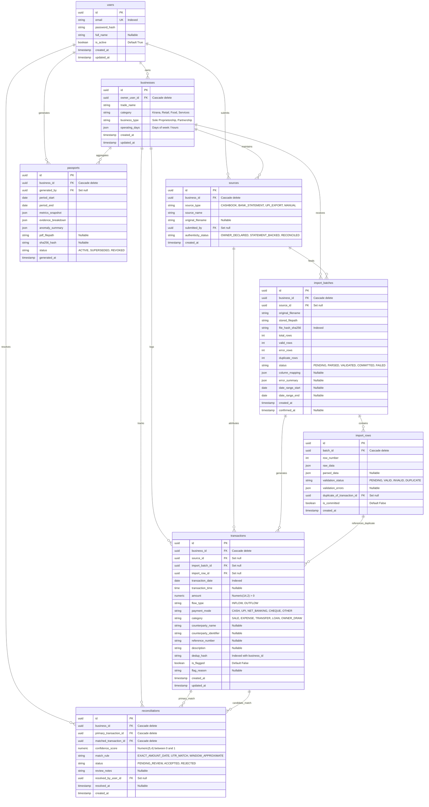

# Database Schema — ArthSetu

> **Status:** APPROVED & IMPLEMENTED (SQLAlchemy 2.0 Declarative Mappings)  
> **Target Database:** PostgreSQL 15 (with SQLite compatibility for isolated test suites)  
> **Key Decisions:** Portable UUID primary keys, exact `Numeric(14,2)` monetary values, positive amount enforcement with `flow_type`, and zero unneeded KYC/address collection for micro-enterprises.

---

## 1. Entity Relationship Diagram

---

## 2. Table Specifications

### 2.1 `users`
| Column | Type | Constraints | Description |
| :--- | :--- | :--- | :--- |
| `id` | `UUID` | `PRIMARY KEY` | Unique user identifier |
| `email` | `VARCHAR(255)` | `UNIQUE`, `NOT NULL`, `INDEXED` | Unique email for authentication |
| `password_hash` | `VARCHAR(255)` | `NOT NULL` | Bcrypt password hash |
| `full_name` | `VARCHAR(255)` | `NULLABLE` | Optional user name |
| `is_active` | `BOOLEAN` | `NOT NULL`, `DEFAULT True` | Account active flag |
| `created_at` | `TIMESTAMPTZ` | `NOT NULL`, `SERVER_DEFAULT now()` | UTC creation timestamp |
| `updated_at` | `TIMESTAMPTZ` | `NOT NULL`, `SERVER_DEFAULT now()` | UTC modification timestamp |

### 2.2 `businesses`
| Column | Type | Constraints | Description |
| :--- | :--- | :--- | :--- |
| `id` | `UUID` | `PRIMARY KEY` | Unique business identifier |
| `owner_user_id` | `UUID` | `NOT NULL`, `FK users.id (CASCADE)` | Owner user account |
| `trade_name` | `VARCHAR(255)` | `NOT NULL` | Operating trade name (e.g. "Gupta Kirana") |
| `category` | `VARCHAR(100)` | `NOT NULL` | Segment (e.g., Kirana, Retail, Apparel) |
| `business_type` | `VARCHAR(100)` | `NOT NULL` | Legal type (Sole Proprietor, Partnership) |
| `operating_days` | `JSON` | `NOT NULL`, `DEFAULT []` | Operational schedule |
| `created_at` | `TIMESTAMPTZ` | `NOT NULL`, `SERVER_DEFAULT now()` | Creation timestamp |
| `updated_at` | `TIMESTAMPTZ` | `NOT NULL`, `SERVER_DEFAULT now()` | Modification timestamp |

### 2.3 `sources`
| Column | Type | Constraints | Description |
| :--- | :--- | :--- | :--- |
| `id` | `UUID` | `PRIMARY KEY` | Unique data source identifier |
| `business_id` | `UUID` | `NOT NULL`, `FK businesses.id (CASCADE)` | Associated business |
| `source_type` | `VARCHAR(50)` | `NOT NULL` | `CASHBOOK`, `BANK_STATEMENT`, `UPI_EXPORT` |
| `source_name` | `VARCHAR(255)` | `NOT NULL` | Friendly name (e.g. "Main Cash Counter") |
| `original_filename`| `VARCHAR(255)` | `NULLABLE` | Name of raw file if uploaded |
| `submitted_by` | `UUID` | `NULLABLE`, `FK users.id (SET NULL)` | Submitting user |
| `authenticity_status`| `VARCHAR(50)` | `NOT NULL`, `DEFAULT OWNER_DECLARED`| Evidence provenance status |
| `created_at` | `TIMESTAMPTZ` | `NOT NULL`, `SERVER_DEFAULT now()` | Creation timestamp |

### 2.4 `import_batches`
| Column | Type | Constraints | Description |
| :--- | :--- | :--- | :--- |
| `id` | `UUID` | `PRIMARY KEY` | Ingestion batch ID |
| `business_id` | `UUID` | `NOT NULL`, `FK businesses.id (CASCADE)` | Target business |
| `source_id` | `UUID` | `NULLABLE`, `FK sources.id (SET NULL)` | Optional linked source |
| `original_filename`| `VARCHAR(255)` | `NOT NULL` | Uploaded filename |
| `stored_filepath` | `VARCHAR(500)` | `NOT NULL` | Private filesystem/storage path |
| `file_hash_sha256` | `VARCHAR(64)` | `NOT NULL`, `INDEXED` | File deduplication checksum |
| `total_rows` | `INTEGER` | `NOT NULL`, `DEFAULT 0` | Total records in file |
| `valid_rows` | `INTEGER` | `NOT NULL`, `DEFAULT 0` | Valid row count |
| `error_rows` | `INTEGER` | `NOT NULL`, `DEFAULT 0` | Malformed row count |
| `duplicate_rows` | `INTEGER` | `NOT NULL`, `DEFAULT 0` | Duplicate row count |
| `status` | `VARCHAR(50)` | `NOT NULL`, `DEFAULT PENDING` | `PENDING`, `PARSED`, `COMMITTED`, `FAILED` |
| `column_mapping` | `JSON` | `NULLABLE` | Detected/mapped column pairings |
| `error_summary` | `JSON` | `NULLABLE` | Parsing & validation diagnostic summary |
| `date_range_start` | `DATE` | `NULLABLE` | Earliest transaction date detected |
| `date_range_end` | `DATE` | `NULLABLE` | Latest transaction date detected |
| `created_at` | `TIMESTAMPTZ` | `NOT NULL`, `SERVER_DEFAULT now()` | Ingestion timestamp |
| `confirmed_at` | `TIMESTAMPTZ` | `NULLABLE` | Commit timestamp into transactions |

### 2.5 `import_rows`
| Column | Type | Constraints | Description |
| :--- | :--- | :--- | :--- |
| `id` | `UUID` | `PRIMARY KEY` | Row record ID |
| `batch_id` | `UUID` | `NOT NULL`, `FK import_batches.id (CASCADE)` | Parent batch |
| `row_number` | `INTEGER` | `NOT NULL` | 1-based line number in file |
| `raw_data` | `JSON` | `NOT NULL` | Raw line as dictionary |
| `parsed_data` | `JSON` | `NULLABLE` | Normalized data |
| `validation_status`| `VARCHAR(50)` | `NOT NULL`, `DEFAULT PENDING` | `VALID`, `INVALID`, `DUPLICATE` |
| `validation_errors`| `JSON` | `NULLABLE` | Field-level error descriptions |
| `duplicate_of_transaction_id`| `UUID` | `NULLABLE`, `FK transactions.id (SET NULL)` | Existing matched collision |
| `is_committed` | `BOOLEAN` | `NOT NULL`, `DEFAULT False` | Converted to transaction flag |
| `created_at` | `TIMESTAMPTZ` | `NOT NULL`, `SERVER_DEFAULT now()` | Row insertion timestamp |

**Indexes:**
- `ix_import_rows_batch_validation`: Composite index on `(batch_id, validation_status)`.

### 2.6 `transactions`
| Column | Type | Constraints | Description |
| :--- | :--- | :--- | :--- |
| `id` | `UUID` | `PRIMARY KEY` | Transaction identifier |
| `business_id` | `UUID` | `NOT NULL`, `FK businesses.id (CASCADE)` | Tenant business scope |
| `source_id` | `UUID` | `NULLABLE`, `FK sources.id (SET NULL)` | Originating source account |
| `import_batch_id` | `UUID` | `NULLABLE`, `FK import_batches.id (SET NULL)`| Batch origin |
| `import_row_id` | `UUID` | `NULLABLE`, `FK import_rows.id (SET NULL)` | Row-level traceability link |
| `transaction_date` | `DATE` | `NOT NULL`, `INDEXED` | Date of business activity |
| `transaction_time` | `TIME` | `NULLABLE` | Time of day if recorded |
| `amount` | `NUMERIC(14,2)`| `NOT NULL`, `CHECK(amount > 0)` | Strictly positive transaction value |
| `flow_type` | `VARCHAR(20)` | `NOT NULL` | `INFLOW` or `OUTFLOW` |
| `payment_mode` | `VARCHAR(50)` | `NOT NULL` | `CASH`, `UPI`, `NET_BANKING`, `CHEQUE` |
| `category` | `VARCHAR(50)` | `NOT NULL` | `SALE`, `EXPENSE`, `TRANSFER`, `LOAN` |
| `counterparty_name`| `VARCHAR(255)`| `NULLABLE` | Name of customer/supplier |
| `counterparty_identifier`| `VARCHAR(255)`| `NULLABLE` | UPI ID / Account / Phone |
| `reference_number` | `VARCHAR(255)`| `NULLABLE` | UTR / Cheque / Bank ref |
| `description` | `VARCHAR(500)`| `NULLABLE` | Narration / item description |
| `dedup_hash` | `VARCHAR(64)` | `NULLABLE` | Hash for rapid O(1) duplicate checks |
| `is_flagged` | `BOOLEAN` | `NOT NULL`, `DEFAULT False` | Flag for review |
| `flag_reason` | `VARCHAR(255)`| `NULLABLE` | Explanatory note (e.g. IQR outlier) |
| `created_at` | `TIMESTAMPTZ` | `NOT NULL`, `SERVER_DEFAULT now()` | Ingestion timestamp |
| `updated_at` | `TIMESTAMPTZ` | `NOT NULL`, `SERVER_DEFAULT now()` | Modification timestamp |

**Indexes & Constraints:**
- `ck_transactions_amount_positive`: `CHECK (amount > 0)`.
- `ix_transactions_business_date`: Composite index on `(business_id, transaction_date)`.
- `ix_transactions_business_dedup`: Composite index on `(business_id, dedup_hash)`.

### 2.7 `reconciliations`
| Column | Type | Constraints | Description |
| :--- | :--- | :--- | :--- |
| `id` | `UUID` | `PRIMARY KEY` | Reconciliation pair identifier |
| `business_id` | `UUID` | `NOT NULL`, `FK businesses.id (CASCADE)` | Scoped business |
| `primary_transaction_id`| `UUID` | `NOT NULL`, `FK transactions.id (CASCADE)`| Base transaction |
| `matched_transaction_id`| `UUID` | `NOT NULL`, `FK transactions.id (CASCADE)`| Matched candidate transaction |
| `confidence_score` | `NUMERIC(5,4)`| `NOT NULL`, `CHECK(0 <= score <= 1)` | Match confidence (0.0000 - 1.0000)|
| `match_rule` | `VARCHAR(100)`| `NOT NULL` | `EXACT_AMOUNT_DATE`, `UTR_MATCH` |
| `status` | `VARCHAR(50)` | `NOT NULL`, `DEFAULT PENDING_REVIEW` | `PENDING_REVIEW`, `ACCEPTED`, `REJECTED` |
| `review_notes` | `VARCHAR(500)`| `NULLABLE` | User review remark |
| `resolved_by_user_id` | `UUID` | `NULLABLE`, `FK users.id (SET NULL)` | Decision reviewer |
| `resolved_at` | `TIMESTAMPTZ` | `NULLABLE` | Decision timestamp |
| `created_at` | `TIMESTAMPTZ` | `NOT NULL`, `SERVER_DEFAULT now()` | Candidate creation timestamp |

**Constraints:**
- `ck_reconciliation_distinct_txns`: `CHECK (primary_transaction_id != matched_transaction_id)`.
- `ck_reconciliation_confidence_range`: `CHECK (confidence_score >= 0 AND confidence_score <= 1)`.

### 2.8 `passports`
| Column | Type | Constraints | Description |
| :--- | :--- | :--- | :--- |
| `id` | `UUID` | `PRIMARY KEY` | Passport identifier |
| `business_id` | `UUID` | `NOT NULL`, `FK businesses.id (CASCADE)` | Scoped business |
| `generated_by` | `UUID` | `NULLABLE`, `FK users.id (SET NULL)` | Requesting user |
| `period_start` | `DATE` | `NOT NULL` | Assessment period start date |
| `period_end` | `DATE` | `NOT NULL` | Assessment period end date |
| `metrics_snapshot` | `JSON` | `NOT NULL` | Frozen financial metric values |
| `evidence_breakdown` | `JSON` | `NOT NULL` | 5-dimension quality scores |
| `anomaly_summary` | `JSON` | `NOT NULL` | Contextual flags and IQR results |
| `pdf_filepath` | `VARCHAR(500)`| `NULLABLE` | Private PDF storage key |
| `sha256_hash` | `VARCHAR(64)` | `NULLABLE` | Digital integrity seal |
| `status` | `VARCHAR(50)` | `NOT NULL`, `DEFAULT ACTIVE` | `ACTIVE`, `SUPERSEDED`, `REVOKED` |
| `generated_at` | `TIMESTAMPTZ` | `NOT NULL`, `SERVER_DEFAULT now()` | Snapshot creation timestamp |

**Indexes & Constraints:**
- `ck_passports_period_valid`: `CHECK (period_start <= period_end)`.
- `ix_passports_business_period`: Composite index on `(business_id, period_start, period_end)`.
